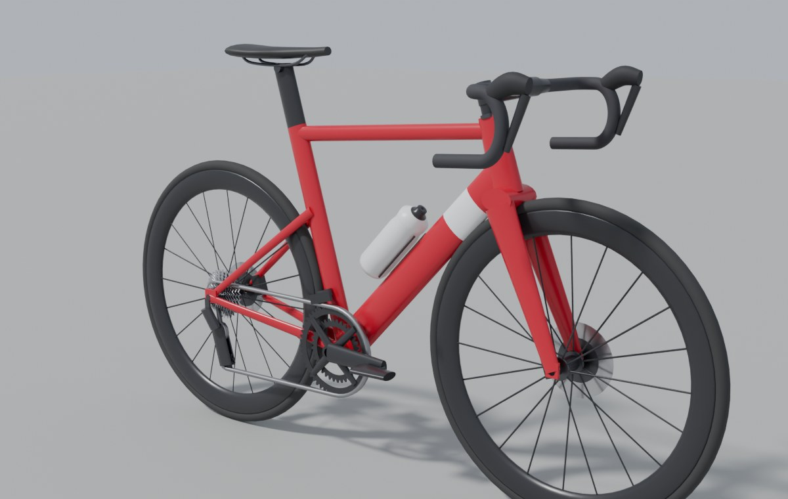
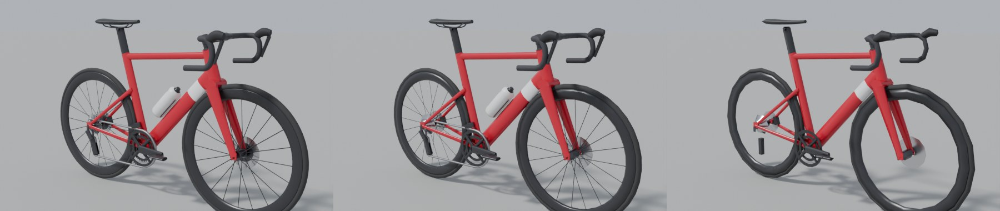

# Virtual Ride Unity — préparation du jeu 3D natif

Ce dossier prépare une version **native** de la course 3D de Wattlas, faite avec le moteur **Unity**, pour **PC**, **casque Meta Quest autonome** et, plus tard, **Xbox**. Les vues 3D actuelles (`VirtualRide3D/`, `VirtualRide3DRealiste/`) tournent dans le navigateur avec three.js ; celle-ci sera une application installée.

| Fichier | Rôle |
| --- | --- |
| [`CONCEPTION.md`](CONCEPTION.md) | Document de conception : cibles, budgets de performance (Quest), modèles 3D, structure du projet Unity, plan de portage du moteur JavaScript en C#, étapes |
| [`blender/velo_route.py`](blender/velo_route.py) | Générateur de vélos de route pour Unity (Blender, Python) |
| [`blender/exemples/`](blender/exemples/) | Un vélo déjà généré (`Velo_Aero.glb`, `.fbx`), son rapport et ses aperçus |
| [`unity/VeloAnimation.cs`](unity/VeloAnimation.cs) | Script Unity qui anime le vélo généré : roues, pédalier, pédales, direction, niveaux de détail |

Le projet Unity lui-même n'existe pas encore : sa structure est décrite dans `CONCEPTION.md`.

## Le générateur de vélos (`blender/velo_route.py`)

Il construit un vélo complet à partir de sa **géométrie** (stack, reach, angles de direction et de selle, douille, bases, drop du boîtier, déport de fourche, tube de selle) et des **réglages du cycliste** (hauteur de selle, potence, cintre, manivelles), puis l'exporte pour Unity. Rien n'est dessiné à la main : on change un paramètre, on relance, le vélo suit.



Pièces : cadre (tubes ronds ou profilés, haubans hauts ou abaissés), fourche, jeu de direction, bagues, potence, cintre route (ou dessus plat aéro, ou évasé gravel) avec guidoline, cocottes et leviers, tige de selle et selle à rails, bidon et porte-bidon, roues (jante à la hauteur du profil, pneu avec flancs beiges en option, moyeu, rayons ronds ou plats, radiaux ou croisés, roue lenticulaire), disques et étriers, pédalier (plateaux dentés, araignée, manivelles), pédales, cassette, chaîne, dérailleurs avant et arrière avec galets.

Le catalogue reprend **les identifiants du magasin de Wattlas** (`Commun/js/engine/catalog.js`), pour qu'un vélo acheté dans le jeu web ait son équivalent dans Unity :

| Option | Valeurs |
| --- | --- |
| `--cadre` | `classic`, `alu`, `endurance`, `climber`, `aero`, `gravel` (pas encore : `tt`, `mtb`, `city`) |
| `--roues` | `box`, `alu`, `climb`, `c45`, `c65`, `c80`, `gravel`, `disc` (lenticulaire à l'arrière, 80 mm à l'avant) |
| `--pneus` | `race` (25 mm, flancs beiges), `road` (28), `tubeless` (30), `training` (32), `gravel` (40, flancs beiges) |

### Lancer

Il faut **Blender 4.2 ou plus récent** (gratuit, [blender.org](https://www.blender.org)). Sans ouvrir Blender :

```sh
blender -b -P VirtualRideUnity/blender/velo_route.py -- --cadre aero --roues c45 --couleur "#C8102E"
```

Ou avec le module Python de Blender (`pip install bpy` ; bpy 5.3 demande Python 3.13) :

```sh
python VirtualRideUnity/blender/velo_route.py --cadre gravel --roues gravel --pneus gravel --couleur "#3E5F4A" --apercu
```

Autres options : `--taille 54` (taille du cadre en cm), `--accent` (couleur de la bande du tube oblique), `--hauteur-selle 0.70`, `--bidons 0|1|2`, `--nom`, `--sortie dossier` (par défaut `sortie/`, ignoré par Git), `--formats glb,fbx,blend`, `--lods 0,1,2`, `--apercu` (rendus JPEG de contrôle avec Cycles, environ 40 s), `--tous` (un vélo par cadre), `--liste` (le catalogue), `--aide`. Tous les paramètres, y compris les cotes du cadre, peuvent aussi venir d'un fichier JSON (`--config mon_velo.json`) :

```json
{ "cadre": "endurance", "taille_cm": 54, "couleur": "#0B6E4F", "geometrie": { "stack": 0.575, "angle_direction": 72.0 },
  "plateaux": [50, 34], "cassette": [11, 12, 13, 14, 15, 17, 19, 21, 24, 28, 32], "pignon_chaine": 19 }
```

### Ce qui sort

Pour un vélo nommé `Velo_Aero` :

| Fichier | Contenu |
| --- | --- |
| `Velo_Aero.glb` | le vélo pour Unity (glTF binaire, textures incluses) : à importer avec **glTFast** |
| `Velo_Aero.fbx` | le même en FBX (textures incluses), pour l'import FBX natif de Unity |
| `Velo_Aero.blend` | (option `blend`) la scène Blender, pour retoucher à la main |
| `Velo_Aero_Palette.png` | la palette de couleurs (16 cases de 16 px) |
| `Velo_Aero_MetalRugosite.png` | métal / rugosité au format glTF (vert = rugosité, bleu = métal) |
| `Velo_Aero_MetalLisse.png` | métal / lissé au format URP (rouge = métal, alpha = lissé), pour régler un matériau URP/Lit à la main |
| `Velo_Aero.rapport.json` | cotes calculées (rayon de roue, empattement, hauteur du boîtier…), transmission, **triangles par pièce et par niveau de détail**, positions des pivots et des ancres en coordonnées Unity |
| `Velo_Aero_apercu*.jpg` | (option `--apercu`) vue de trois quarts, gros plan de la transmission, **vue du cycliste** (ce qu'on voit dans le casque), profil, planche des trois niveaux de détail |

Triangles du vélo aéro de l'exemple : **LOD0 27 972** (vélo du joueur, vu de près dans le casque), **LOD1 7 564**, **LOD2 2 640** (peloton lointain).



### Conventions (à garder pour tous les modèles du jeu)

- **Unités** : 1 unité = 1 mètre.
- **Axes** : dans Blender, le vélo regarde vers −Y, Z en haut ; dans Unity il regarde vers **+Z** (axe bleu), **Y** en haut, la transmission à **droite (+X)**.
- **Origine** : au sol, au milieu de l'empattement. Posé sur une pente et incliné de la pente, le vélo touche la route par ses deux roues.
- **Hiérarchie et pivots** : les pièces qui bougent sont sur leur propre pivot, au bon endroit.

  ```
  Velo_Aero                    (racine)
  ├─ Cadre_LOD0/1/2            cadre, selle, bidon, chaîne, dérailleurs, étrier arrière
  ├─ Ancre_Selle
  ├─ Pivot_Direction           sur l'axe de direction (bas de la douille), axe Y local le long du pivot
  │  ├─ Direction_LOD0/1/2     fourche, potence, cintre, cocottes, étrier avant
  │  ├─ Repere_AxeDirection    un 2ᵉ point de l'axe de direction (haut de la douille)
  │  ├─ Ancre_MainD/G_Cocotte, Ancre_MainD/G_Bas, Ancre_MainD/G_Haut
  │  └─ Pivot_RoueAvant        axe de la roue avant
  │     └─ RoueAvant_LOD0/1/2  pneu, jante, rayons, moyeu, disque
  ├─ Pivot_RoueArriere
  │  └─ RoueArriere_LOD0/1/2   + cassette
  └─ Pivot_Pedalier            axe du boîtier
     ├─ Pedalier_LOD0/1/2      plateaux, araignée, manivelles (droite vers l'avant)
     ├─ Pivot_PedaleD → PedaleD_LOD0/1/2, Ancre_PiedD
     └─ Pivot_PedaleG → PedaleG_LOD0/1/2, Ancre_PiedG
  ```

- **Ancres** : des objets vides où poser les mains, les pieds et le bassin du cycliste (cibles de cinématique inverse, paquet *Animation Rigging* de Unity). Les ancres des pieds tournent avec les pédales.
- **Niveaux de détail** : chaque pièce existe en `_LOD0`, `_LOD1`, `_LOD2`. L'import FBX de Unity crée le *LOD Group* tout seul d'après ces suffixes ; pour le `.glb`, `VeloAnimation` le crée au démarrage.
- **Un seul matériau par vélo** : toutes les faces pointent une case d'une palette de 64 × 64 px (couleur, métal, rugosité). Un vélo coûte donc un appel de dessin par pièce (7 au total), et tous les vélos d'un peloton partagent les mêmes maillages : Unity peut les dessiner en lots (*instancing*). La couleur du cadre est la case `peinture` : un autre vélo = une autre palette.
- **Faces** : toutes orientées vers l'extérieur (vérifié à la construction), matériau à une seule face (Unity ne dessine pas l'arrière des faces).

### Importer dans Unity

**En `.glb` (conseillé)** : installer le paquet **glTFast** (*Package Manager › + › Install package by name* : `com.unity.cloud.gltfast`), puis glisser le `.glb` dans `Assets/`. Il devient un préfab.

**En `.fbx`** : glisser le `.fbx` dans `Assets/`, puis dans l'inspecteur du modèle :

- onglet *Model* : cocher **Bake Axis Conversion** (sinon la racine reçoit une rotation de −90° sur X) ;
- onglet *Materials* : *Extract Textures*, puis régler le matériau en *Universal Render Pipeline/Lit*, avec `Velo_Aero_MetalLisse.png` en *Metallic Map* (source du lissé : *Metallic Alpha*).

Dans les deux cas, pour les textures de palette : **Generate Mip Maps décoché** et **Filter Mode : Point**. Sinon, des liserés de couleur apparaissent à la jonction de deux pièces.

**Animer** : copier [`unity/VeloAnimation.cs`](unity/VeloAnimation.cs) dans `Assets/` et l'ajouter au vélo. On règle `vitesse` (m/s), `cadence` (tr/min) et `braquage` (°) depuis la simulation ; `rayonRoue` vient du rapport (`geometrie.rayon_roue`). Les pédales tournent à l'envers du pédalier pour rester à plat. Les axes de rotation sont déduits des positions des pivots, donc le script fonctionne quel que soit le chemin d'import. Cochez `toujoursLod0` sur le vélo du joueur.

### Vérifications faites

- Le script tourne avec Blender 5.3 (module `bpy`) : les six cadres, les trois niveaux de détail, les exports `.glb`, `.fbx` et `.blend`, un fichier de configuration, un mono-plateau avec pignon de 10 dents, la roue lenticulaire, deux bidons.
- Toutes les pièces sortent orientées vers l'extérieur dès la construction (aucune n'a dû être retournée).
- Le `.glb` a été relu : hiérarchie, pivots, matériau à une face, textures incluses, filtrage « au plus proche ».
- Le `.fbx` a été réimporté dans Blender : pivots et ancres à moins de 0,1 mm de leur place.
- `VeloAnimation.cs` compile (Mono, contre une API Unity simulée).
- **Pas encore testé dans Unity** : l'import réel, le *LOD Group* automatique du FBX, le sens des rotations à l'écran.

### Limites

- Pas encore de vélo de contre-la-montre, de VTT ni de vélo de ville ; pas de crampons sur les pneus gravel ; pas de logos.
- La chaîne est un ruban lisse : les maillons viendront d'une texture de relief si on les voit de près.
- Les tubes se croisent aux jonctions, sans raccords soudés : on ne le voit pas en jeu, mais ce n'est pas un modèle de fabrication.
